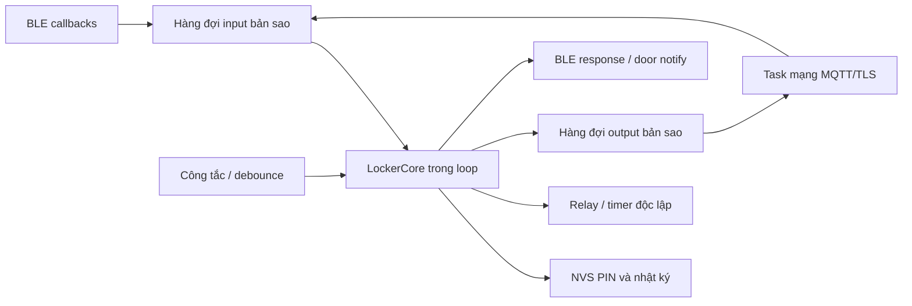

# Phân tích và kết quả xây dựng lại firmware

Ngày kiểm tra: 19/10/2026. Firmware được xây dựng mới từ hợp đồng BE/FE và cấu hình phần cứng người dùng xác nhận. Không lấy logic từ sketch Arduino cũ. Không sửa BE, FE hoặc mobile; không chạy migration, không nạp board, không xóa NVS hoặc dữ liệu DB.

## 1. Project Analysis

### Phạm vi đọc và phương pháp kiểm tra

Đã quét nội dung, cấu trúc lớp, các API, từ khóa giao tiếp và lập hash cho 316 tệp BE, 69 tệp web, 85 tệp mobile, tổng cộng 71.319 dòng kể cả tài liệu và mã EF sinh tự động. Đây là quét toàn bộ danh mục, không phải tuyên bố mọi dòng UI hoặc migration đều đã được review thủ công. Các luồng điều khiển phần cứng và nghiệp vụ liên quan được đọc chi tiết. Danh sách đầy đủ nằm trong `source-inventory.json`.

Nhóm nguồn được đối chiếu chi tiết:

- `smart-locking-be.Infrastructure/Services/MqttLockerCommandDispatcher.cs`, `MqttLockerListenerService.cs`, `LockerAccessService.cs`: topic, payload lệnh, trạng thái cửa và hoàn tất nghiệp vụ.
- `BluetoothProtocol.cs`, `OfflinePinService.cs`, `OfflineReturnSync.cs`, `OfflinePinProvisioner.cs`, `OfflinePinNotificationWorker.cs`: c1/r1/o1/q1/k1, thứ tự nhật ký, PIN một lần và thông báo.
- `Application/Services/BluetoothWorkflowService.cs`, `Persistence/BluetoothWorkflowStore.cs`: D/P/R/G/N, kiểm tra resident, guest session và tủ được chọn.
- `DeliveryRequestService.cs`, `ReturnRequestService.cs`, `ParcelPickupService.cs`, `ParcelRetrievalEligibility.cs`, `EmergencyUnlockService.cs`: phê duyệt, cấp ngăn, phí, nhận/gửi và mở vận hành.
- Các controller Bluetooth, offline sync, delivery, return, parcel, locker, operations; các DTO, enum, entity và cấu hình EF liên quan.
- `BaseConfiguration.cs`, `OfflineLockerEventConfiguration.cs`, `LockerCompartmentConfiguration.cs` và migration Bluetooth: tên bảng dạng số ít, khóa duy nhất `(DeviceIdentifier, Sequence)`, ngăn theo `(LockerId, HardwareChannel)`.
- Web `src/App.tsx`, `services/operations-service.ts`, trang quản lý và chi tiết tủ, kiểu dữ liệu và dịch vụ API: web hiện chủ yếu là Admin/Operator. Route shipper và Web Bluetooth chưa xuất hiện trong source hiện tại.
- Mobile `src/features/{parcels,returns,delivery-requests,notifications,auth}`, các API/kiểu dữ liệu, màn hình nhận/gửi, package.json và README: gọi HTTP để gửi/nhận; chưa có thư viện hoặc luồng BLE hiện thực.
- Trang test độc lập `D:/code_capstone/resident-bluetooth-test/app.js`: UUID, frame, requestId, cách đọc đầy đủ phản hồi sau notify, cách lấy nhật ký và chuyển ACK.
- `Report3_Software Requirement Specification_working.docx`: phần 3.5, 3.10, 4.1.3–4.1.4 và BR-19/BR-20. Report 3 yêu cầu mở bằng app/Bluetooth, công tắc cửa và kiểm tra phí. Không mô tả chi tiết gói BLE hoặc GPIO.
- `Report4_Software Design Documen_working.docx`: mô hình dữ liệu và các hình sequence MQTT/gửi/nhận; mục Bluetooth 3.4.4 hiện chỉ có tiêu đề, chưa có hình sequence. Không coi tiêu đề này là một giao thức đã triển khai.
- README Arduino tại thời điểm bắt đầu: GPIO, mức cửa LOW/HIGH, tối đa bốn kênh, ESP32 và cách tạo Device ID. Người dùng xác nhận relay HIGH trong 2 giây và toàn bộ bảng chân.

Các tài liệu Bluetooth cũ trong BE có thông tin không còn khớp: phần đăng ký resident cho phép bỏ tủ đã được người dùng yêu cầu khôi phục về `Guid RegisteredLockerId`. Source hiện tại được ưu tiên khi có khác biệt với tài liệu.

### Kiến trúc và thiết bị

Web/mobile → HTTP/BE → MQTT/TLS → ESP32. Với Bluetooth: app/web → GATT → ESP32; dữ liệu hoàn tất trở lại BE qua MQTT hoặc được điện thoại chuyển tiếp qua HTTP. ESP không nhận JWT hoặc tự gọi các REST API người dùng.

ESP32 Dev Module, flash 4 MB, PSRAM disabled; cấu hình build đã dùng Huge APP 3 MB / No OTA theo ảnh người dùng. Phần cứng đã xác nhận:

| Kênh | Relay | Công tắc cửa |
|---|---|---|
| 1 | GPIO 23 | GPIO 32 |
| 2 | GPIO 22 | GPIO 33 |
| 3 | GPIO 21 | GPIO 25 |
| 4 | GPIO 19 | GPIO 26 |

Relay HIGH = kích mở 2 giây, LOW = ngắt. Công tắc INPUT_PULLUP, LOW = đóng, HIGH = mở, chống dội 50 ms. Cảm biến không xác nhận bên trong có hàng.

Theo README gốc, tủ A `LKR-309228` có bốn ngăn, tủ B `LKR-1A0844` có một ngăn. Không tự sửa DB để ép số ngăn. Số kênh phần cứng tối đa của bộ firmware này là bốn, đúng giới hạn channel trong BE hiện tại.

### Hợp đồng thực tế

| Chiều | Topic tương đối `lockers/{device}/` | Dữ liệu |
|---|---|---|
| BE → ESP | `doors/{1..4}` | `c1|device|subject|channel|D/P/R/G|phone|pin-or--|expiry|commandId` |
| BE → ESP | `doors/{1..4}` | `OPEN`, `OPEN:{deliveryId}`, `OPEN:OPERATOR` cho luồng legacy/vận hành |
| BE → ESP | `inventory` | `bluetoothEnabled:busyMask` |
| BE → ESP | `pins` | `channel:deliveryId:phone:pin` |
| BE → ESP | `workflow/response` | `requestId|c1...` hoặc `requestId|FAIL:...` |
| BE → ESP | `events/offline/ack` | `k1|eventId` |
| ESP → BE | `doors/{channel}/status` | `OPEN` / `CLOSED`, retained |
| ESP → BE | `workflow/request` | `requestId:kind:subjectId:residentPermit` |
| ESP → BE | `events/pin-ready` | `q1|deliveryId|pin` |
| ESP → BE | `events/offline` | `o1|eventId|subjectId|device|channel|kind|phone|pin-or--|opened|closed|elapsed|sequence` |

D/P dùng DeliveryRequest ID trên dây, không dùng Parcel ID. R/G dùng ReturnRequest ID. UUID trên dây có 32 ký tự hex, không có dấu gạch. PIN luôn là chuỗi sáu số để giữ số 0 đầu.

BLE giữ service fff0 và fff1 ghi lệnh, fff2 đọc/notify kết quả, fff3 đọc device ID, fff4 đọc/notify cửa. UUID đầy đủ có hậu tố `-0000-1000-8000-00805f9b34fb`. Frame `requestId|body`, requestId dương tối đa 10 chữ số, frame tối đa 400 byte. Không chấp nhận mã nội bộ 0 từ BLE. Notify fff2 là tín hiệu có dữ liệu; client phải đọc characteristic để lấy toàn bộ kết quả.

## 2. Firmware Architecture

`LockerCore` sở hữu duy nhất State; task mạng không đọc hoặc ghi State. Callback chỉ xác minh kích thước/định tuyến và sao chép input vào hàng đợi. Không giữ khóa dữ liệu trong khi DNS/TLS chờ mạng. Outbound giữ nguyên bản tin gửi lỗi qua các lần reconnect. Nhật ký vẫn ở NVS cho đến ACK, nên việc gửi trùng không làm mất dữ liệu; BE khử trùng theo event ID và sequence.

State machine: `Empty → Depositing → Stored → PickingUp → Empty`. Relay bật chỉ là chấp nhận lệnh; phải thấy cửa mở rồi đóng ổn định mới tạo record. PIN bị vô hiệu hóa ngay khi bắt đầu PickingUp. Cửa không mở sau 60 giây hoặc còn mở sau thời hạn 120 giây chỉ báo lỗi, không tự hoàn tất hay giải phóng ngăn.

| Module | Vai trò |
|---|---|
| `Config.h` | GPIO và hằng số đã xác minh, UUID, giới hạn nhật ký |
| `Protocol.h/.cpp` | Đọc/ghi đúng định dạng BE, kiểm tra độ dài, số tràn, ID, PIN |
| `LockerCore.h/.cpp` | D/P/R/G, offline RETURN, PREPARE, PIN, trạng thái, ACK và nhật ký |
| `Hardware.h/.cpp` | Relay LOW khi boot, timer ngắt độc lập sau 2 giây, debounce cửa |
| `StateStore.h/.cpp` | Lưu NVS, kiểm tra phiên bản/nội dung; lỗi thì giữ nguyên dữ liệu và chặn mở mới |
| `Transports.h/.cpp` | NimBLE, MQTT/TLS trong task riêng, reconnect/backoff, các hàng đợi |
| `QueuePump.h` | Giữ bản tin gửi thất bại và gửi lại đúng thứ tự |
| `firmware.ino` | Khởi tạo và nối các module; loop xử lý input/cảm biến và tick core |

## 3. Implementation Result

Đã triển khai:

- MQTT online D/P/R/G, lệnh mở quản trị và legacy có kiểm tra kênh/cửa.
- App có mạng, tủ mất mạng: EXEC chuyển lệnh BE qua BLE.
- App mất mạng, tủ có mạng: PREPARE chuyển permit tới BE và trả kết quả đúng requestId; kết quả đến sau timeout không tự mở.
- Cả hai mất mạng: RETURN tạo mới đồ resident gửi với permit đã lưu trước, chọn ngăn được inventory cho phép; PICKUP dùng PIN inbound đã nạp trước.
- PIN sáu số, không sinh trùng giữa các ngăn đang sử dụng; BE cấp PIN thì giữ nguyên, xung đột thì từ chối thay vì đổi âm thầm.
- Ba lần nhập PIN sai khóa thao tác 60 giây; trạng thái và ACK vẫn đọc/xử lý được để đối soát.
- Lệnh/giao dịch lặp không kích relay lại. Mất phản hồi đầu có thể lấy lại PIN của giao dịch đã chấp nhận qua ALREADY_ACCEPTED.
- LIST/RECEIPT/ACK để app/web chuyển nhật ký; RECEIPT cần PIN của giao dịch.
- Lưu tối đa 16 nhật ký; trước khi nhận gửi mới dành cả chỗ cho lần gửi và lần nhận. Đầy thì báo SYNC_REQUIRED.
- Retry MQTT với backoff 1–30 giây, tự nối lại Wi-Fi, gửi lại trạng thái cửa sau reconnect.
- TLS dùng CA có sẵn trong ESP32 core; không thêm khóa HMAC, grant hoặc cơ chế gửi SMS. Không giả giờ từ ngày biên dịch. NTP chưa sẵn sàng được báo rõ trên Serial.
- Bản mới dùng NVS namespace `locker_core_v1`, version riêng. Không đọc/xóa/migrate dữ liệu thử nghiệm của firmware cũ. Namespace này giữ nguyên qua các lần nạp lại cùng cấu trúc.

Giữ nguyên `firmware/secrets.h`. Cấu hình mẫu không chứa bí mật nằm ở `firmware/secrets.example.h`. Thông tin đăng nhập chỉ được include trong sketch; không ghi PIN, permit hoặc mật khẩu ra log.

Đã bổ sung `tests/`, `.clang-format`, README mới, báo cáo này và inventory nguồn. Không tạo API, bảng DB, migration hoặc chức năng client mới.

## 4. Verification

Kết quả kiểm tra được ghi theo đúng tầng:

- 79 kiểm tra core/contract và lỗi: frame, sai tủ/kênh, hết hạn/chưa có giờ, lưu thất bại, timer thất bại, chống mở lặp, D/P/R/G, PIN một lần, NVS sai định dạng, ACK lặp, nhật ký đầy, replay và reconnect.
- Đã chạy thêm 10.000 trường hợp chuỗi ASCII ngẫu nhiên và sai định dạng vào parser, gồm độ dài vượt giới hạn, trường rỗng, ký tự điều khiển và số tràn; không có ngoại lệ ngoài dự kiến. Đây không phải kết quả memory sanitizer hoặc fuzz trên board.
- 17 kiểm tra adapter GPIO/timer bằng giả lập: relay LOW khi boot, debounce 50 ms, nhiễu ngắn, cửa mở không cho kích, timer độc lập tự ngắt đúng 2 giây kể cả không chạy loop, lỗi timer đưa relay về LOW.
- Kiểm tra C# dùng chính `BluetoothProtocol.cs`, interface và DTO hiện tại của BE: sinh bốn lệnh BE thật → chạy core C++ mới với chu kỳ cửa → parser BE đọc bốn record D/P/R/G và xác nhận sequence/PIN/ACK.
- 64 test hiện có của BE PASS. Không thay source BE để làm test qua.
- Từ máy tính: TLS 1.2 xác minh chứng chỉ và MQTT CONNECT/CONNACK dùng cấu hình hiện có PASS. Chỉ CONNECT/DISCONNECT, không publish lệnh, không tác động relay. Kết quả này không phải kết nối TLS trên ESP32.
- Build đã PASS: Flash 1.360.618 byte (43% phân vùng Huge APP), RAM tĩnh 61.968 byte (18%). RAM này chưa tính heap Wi-Fi/BLE/TLS khi chạy; không gọi phần còn lại là heap trống thực tế.
- Build ESP32 core 3.3.12, NimBLE-Arduino 2.5.1, PubSubClient 2.8, board `esp32:esp32:esp32`, partition `huge_app`.
- Chưa nạp firmware hoặc kiểm thử điện áp, sóng BLE, TLS/heap/stack thực tế, relay và công tắc trên board. Chưa chạy soak test dài giờ. Không dùng kết quả build để tuyên bố phần cứng đã ổn định.

Chạy lại bằng `tests/run-tests.ps1`; dữ liệu chạy thử lưu trong thư mục tạm. Bộ test C# chỉ link các file codec của BE, không sửa BE và không truy cập DB.

## 5. Remaining Issues và điều kiện triển khai

1. **Client BLE chưa có trong mobile/web hiện tại.** Firmware hỗ trợ hợp đồng đã tồn tại trong BE và trang test, nhưng đội client vẫn cần tích hợp GATT, lưu permit, sync và ACK. Không coi có firmware là app/web đã chạy offline được.
2. **Không có dữ liệu phí cập nhật tại tủ khi offline hoàn toàn.** Report 3 yêu cầu chặn phí bắt buộc; BE kiểm tra ở prepare/online nhưng PIN local không có thông tin phí mới nhất. Đây là khoảng trống nghiệp vụ của hợp đồng hiện tại, không thể bảo đảm chặn phí tuyệt đối bằng firmware đơn lẻ. Source BE nhận physical pickup rồi có thể đánh dấu NeedsReview. Cần chốt nghiệp vụ với BE trước nghiệm thu tính năng này.
3. **Inventory chỉ có busy mask.** Không phân biệt được ngăn không tồn tại và ngăn bận. Firmware chặn bit 1, không tự suy luận ngăn đó trống; STATUS vẫn mô tả tối đa bốn vị trí. Để giao diện chỉ hiện số ngăn thực tế, client cần dùng danh sách ngăn từ BE; không tự thêm ngăn DB.
4. **Sequence thuộc từng thiết bị.** Đã đọc DB hiện tại ở chế độ chỉ đọc: chưa có cursor cho LKR-1A0844 và LKR-309228 tại thời điểm kiểm tra. Nếu DB khác đã có lịch sử, phải đối chiếu cursor và dữ liệu NVS trước lần triển khai mới; không xóa dữ liệu hoặc reset sequence tự động. Không áp dụng firmware mới lên tủ đang chứa hàng/nhật ký cũ chưa đối soát mà không bàn giao dữ liệu trước.
5. **BE không có topic telemetry/Last Will được xử lý để tự đánh dấu offline.** Firmware không bịa topic mới. `STATUS:OFFLINE` nghĩa MQTT của tủ chưa kết nối, không khẳng định Wi-Fi đã mất. Việc BE đánh dấu offline toàn hệ thống cần xử lý ở BE theo yêu cầu riêng.
6. **Mã offline có thể trùng lịch sử BE mà tủ không biết.** Firmware tránh trùng PIN giữa ngăn đang có hàng; không thể biết toàn bộ ReturnCode lịch sử khi offline. BE có luồng NeedsReview; không âm thầm đổi mã resident đã chia sẻ.
7. **NTP/TLS:** Wi-Fi có IP chưa đủ để TLS thành công. Core không tin giờ tự khai hoặc ngày build. Cần mạng truy cập broker TLS và NTP, ACL cho các topic đã liệt kê. Serial có mã lỗi TLS dạng số, thời gian kết nối, heap/max block và stack để kiểm tra trên thiết bị.
8. Không có nguồn chứng minh module camera, màn hình, keypad, cân hoặc modem SMS đang được lắp/đấu nối; không tự thêm driver cho các thiết bị đó. Enum nhận diện khuôn mặt trong BE không đủ để suy ra có camera trên ESP32.

9. **Thu hồi PIN khi vận hành chuyển/tịch thu hàng:** `ParcelService.cs`/`OperationsService.cs` có thao tác Removed nhưng chưa phát bản tin thu hồi PIN có định danh xuống ESP. OPEN:OPERATOR chỉ là mở kiểm tra, không đủ chứng minh đã lấy hàng để xóa PIN hoặc đổi Stored thành Empty. Firmware không tự suy diễn từ inventory mask để làm mất dữ liệu. Luồng clearance/thu hồi PIN cần hợp đồng BE bổ sung trước nghiệm thu vận hành đầy đủ.

10. **ACK lệnh mở trong sơ đồ và source chưa khớp:** hình sequence Report 4 mô tả BE nhận MQTT Unlock Success/Failure trước khi trả kết quả API. Source `LockerAccessService` hiện chỉ xác nhận dispatch, chưa chờ kết quả phần cứng; listener không định nghĩa topic ACK lệnh tương ứng. Firmware phát trạng thái cửa và nhật ký đúng hợp đồng đang có, không tự tạo topic mới. Vì vậy API Succeeded chưa đồng nghĩa chốt đã mở thực tế.

Các giới hạn trên được giữ rõ thay vì sửa BE/FE ngoài phạm vi hoặc tuyên bố đã nghiệm thu phần cứng.
